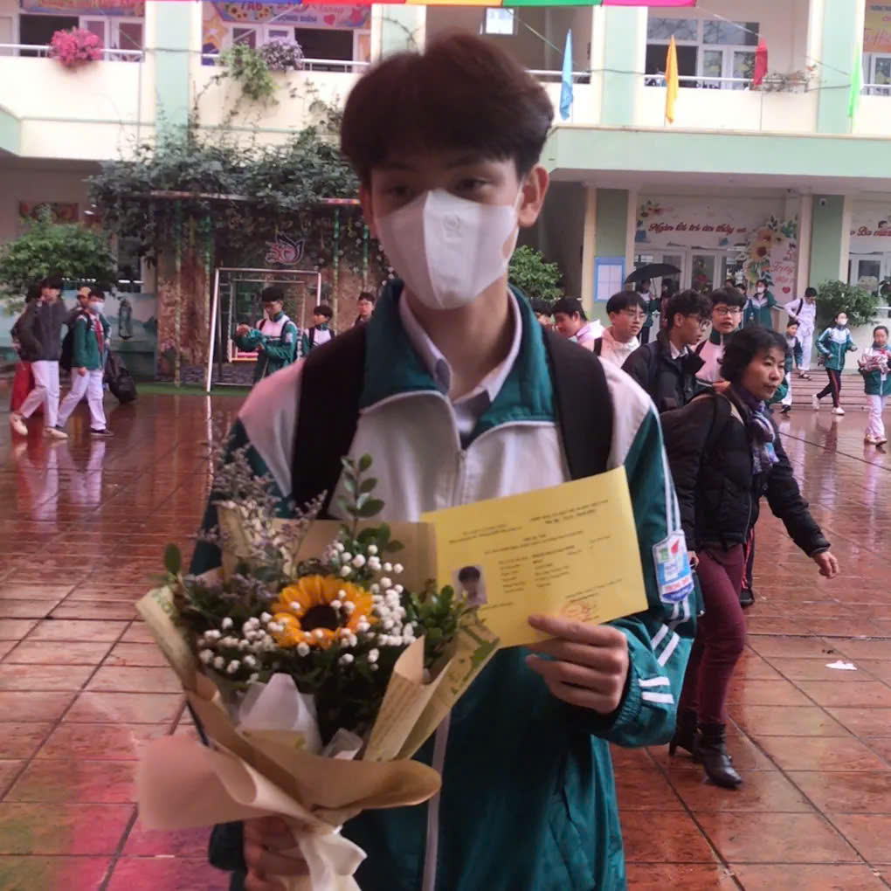
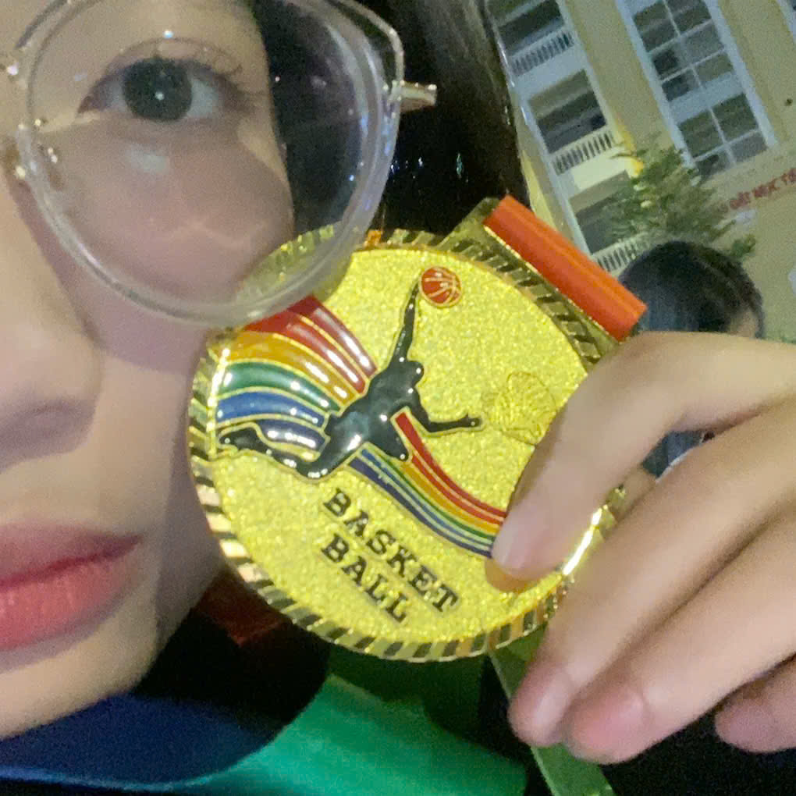

<h1 align="center">GIỚI THIỆU VỀ BẢN THÂN</h1>

I/ Một số thông tin cơ bản:

- Tên mình là: Phạm Trần Hải Ninh - Birthday: 02/01/2009 - Quê quán: Cẩm Đông, Cẩm Giàng, Hải Dương - Học sinh lớp: 12A4 tại trường THPT Hòn Gai

II/ Một vài sở thích cá nhân của mình là:

<ul>
<li>Xem phim và nghe nhạc mỗi khi làm việc nhà hoặc làm bài tập</li>
<li>Chơi thể thao: Bóng đá, Bóng rổ,...</li>
<li>Chơi điện tử, trò chơi trực tuyến cùng bạn bè</li>
<li>Môn học yêu thích của mình là Toán</li>
</ul>

- Đây là cầu thủ bóng đá yêu thích nhất của mình

- Đây là bài hát yêu thích của mình

<iframe width="560" height="315" src="https://www.youtube.com/embed/QxXYWMIQAcQ?si=QaXbA4EJ_ALOkmby" title="YouTube video player" frameborder="0" allow="accelerometer; autoplay; clipboard-write; encrypted-media; gyroscope; picture-in-picture; web-share" referrerpolicy="strict-origin-when-cross-origin" allowfullscreen></iframe>

III/ Các trường đại học mơ ước:

- Vì mình dự định thi khối ngành kĩ thuật nên đây là những ngôi trường mình đang muốn hướng đến: 

<ul>
<li>Đại học Bách khoa Hà Nội (HUST)</li>
<li>Trường Đại học Công nghệ – ĐHQG Hà Nội (VNU-UET)</li>
<li>Trường Đại học Xây dựng Hà Nội (NUCE)</li>
<li>Trường Đại học Giao thông vận tải (UTC)</li>
<li>Trường Đại học Công nghiệp Hà Nội (HaUI)</li>
</ul>

IV/ Một vài thành tích mình đã đạt được:>

- Lần lượt là năm lớp 9 được tham gia thi học sinh giỏi cấp tỉnh môn sinh học, sau đó lên lớp 10 thì đạt được huy chương vàng bóng rổ nội dung 3x3

- Đây là trang cá nhân facebook của mình:

<a href="https://www.facebook.com/share/1F9zCZ9znF/?mibextid=wwXIfr"
target="_blank">

</a>
